

  <a href="https://edisonkz.netlify.app/">
    
  </a>

  

    
    
    
    
    
    
  

---

  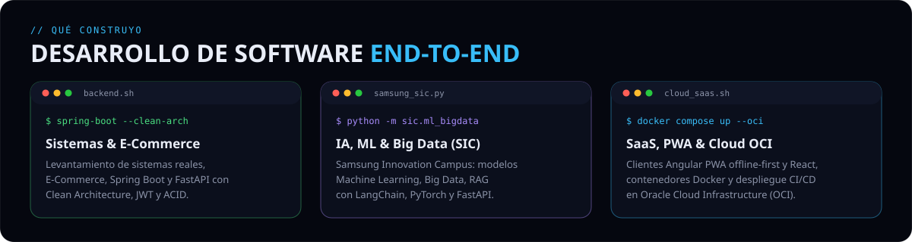

 

  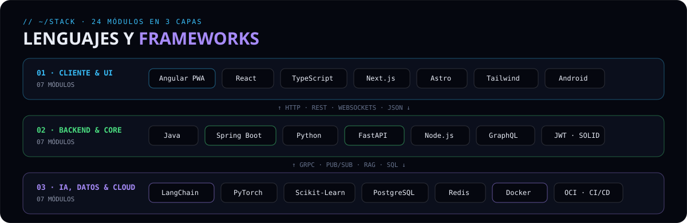

 

  <a href="https://edisonkz.netlify.app/proyectos">
    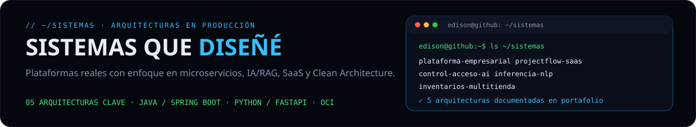
  </a>

  <a href="https://edisonkz.netlify.app/sistemas/plataforma-empresarial">
    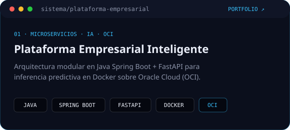
  </a>
  <a href="https://edisonkz.netlify.app/sistemas/projectflow">
    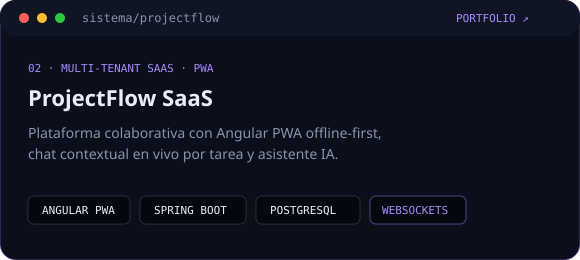
  </a>

  <a href="https://edisonkz.netlify.app/sistemas/control-acceso">
    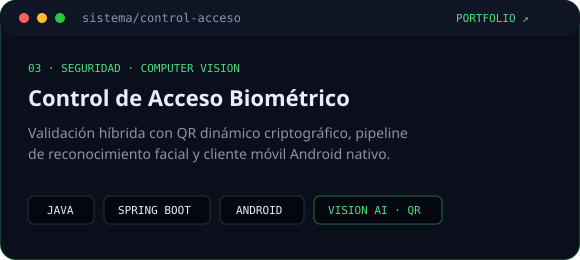
  </a>
  <a href="https://edisonkz.netlify.app/sistemas/inferencia-ia">
    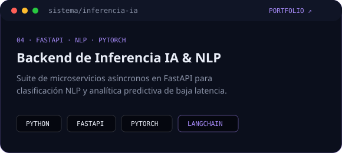
  </a>

  <a href="https://edisonkz.netlify.app/sistemas/inventarios-multitienda">
    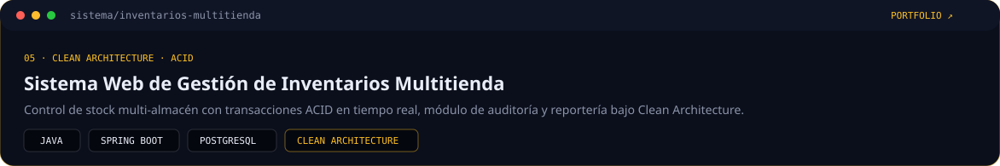
  </a>

  <a href="https://github.com/Edisonkz/FhashMusic">
    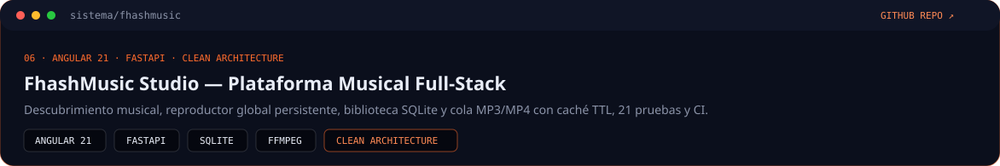
  </a>

 

  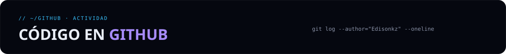

  
  

  

 

  <picture>
    <source media="(prefers-color-scheme: dark)" srcset="https://raw.githubusercontent.com/Edisonkz/Edisonkz/output/github-contribution-grid-snake-dark.svg">
    <source media="(prefers-color-scheme: light)" srcset="https://raw.githubusercontent.com/Edisonkz/Edisonkz/output/github-contribution-grid-snake.svg">
    
  </picture>

 

  Crafted with clean architecture by <a href="https://edisonkz.netlify.app/"><b>Edison Edgar Sivipaucar Quispe</b></a> · Peru (UTC-5) · <a href="https://edisonkz.netlify.app/en/">English Version</a>

